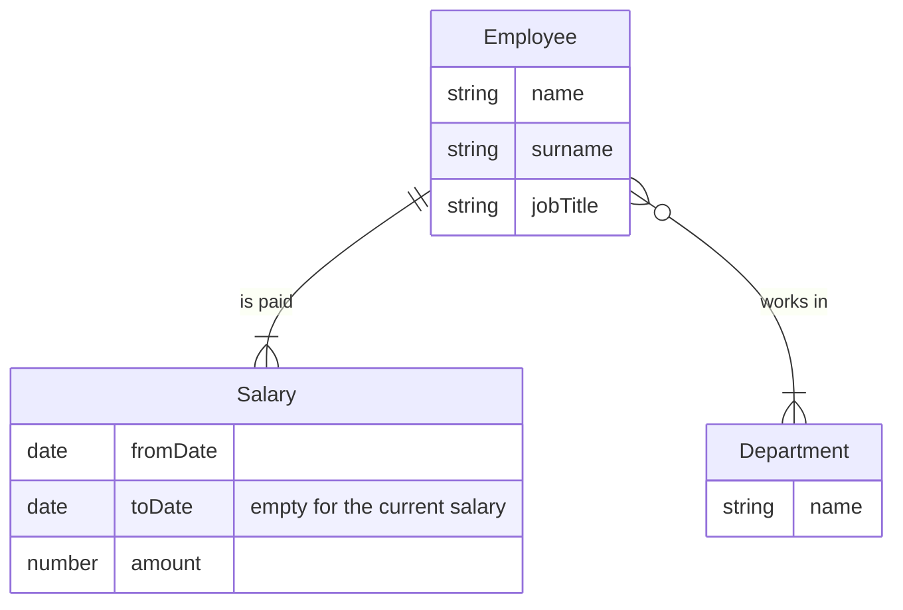

# ICEAdmin: logical ERD

The many-to-many relationship between Employee and Department is left as it is. A logical design describes the data, not how a particular database will store it. Checkpoint 03 deals with it.

Reading the relationships:

- Employee to Salary: each salary belongs to exactly one employee. Each employee has one or many salaries (the current one, plus any past ones).
- Employee to Department: each employee works in one or many departments ("at least one"). Each department has zero or many employees. A newly created department may not have any yet.
