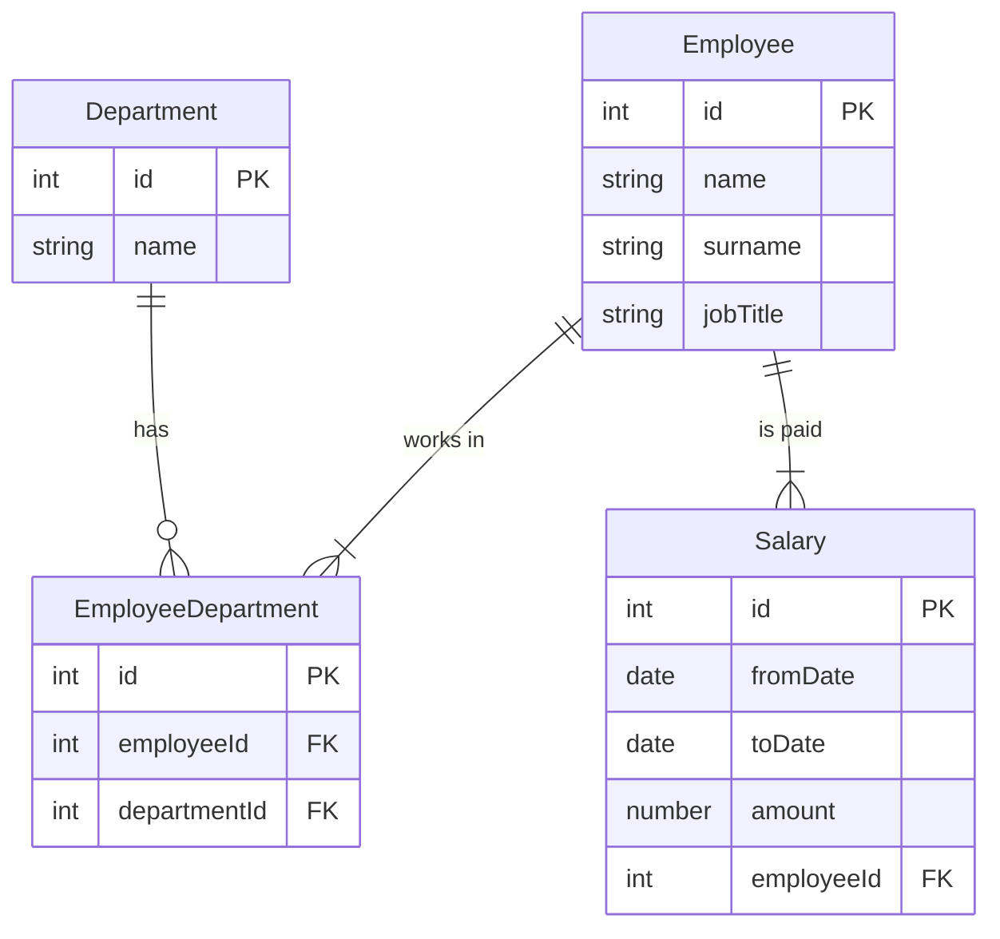

# Checkpoint 03: Many-to-many relationships

## Goal

Understand why a many-to-many relationship can't be stored with a single foreign key, and resolve it with a linking table.

## Concepts

ICEAdmin's scenario says every employee works in at least one department, and some work in more than one. Read in both directions, that means:

- one employee can work in many departments
- one department has many employees

That is a many-to-many relationship. A logical ERD can show it as it is (see checkpoint 02). A relational database can't represent it with a single foreign key, so a physical design needs a linking table. ERD Editor offers no many-to-many option for the same reason.

### What goes wrong

Try to store ICEAdmin as three tables, with a `departmentId` foreign key in Employee:

Employee

| id | name | surname | jobTitle | departmentId |
|---|---|---|---|---|
| 1 | Joe | Doe | Admissions Team | 2 |
| 2 | Lucy | Pace | Academic Team | 1,3 |

Department

| id | name |
|---|---|
| 1 | Academic Team |
| 2 | Admissions Team |
| 3 | QA Team |

Salary

| id | fromDate | toDate | amount | employeeId |
|---|---|---|---|---|
| 1 | 2019-01-01 | 2022-12-31 | 28000.00 | 1 |
| 2 | 2023-01-01 | | 30000.00 | 1 |
| 3 | 2022-02-27 | | 32000.00 | 2 |

Salary is fine. Each salary belongs to one employee, so `employeeId` always holds one value.

Lucy's `departmentId` is the problem. It holds `1,3`, which is two values in one cell. Columns must hold atomic values: one value per cell, not a list. A list breaks everything a database does well. A foreign key can't check that `1,3` points at real departments. "Who works in QA?" turns into text searching. Removing Lucy from one department means editing a string.

Moving the foreign key the other way, putting `employeeId` in Department, fails in the same way, because a department has several employees.

### The fix: a linking table

Add an entity whose only job is to record each pairing of an employee and a department. The many-to-many relationship becomes two one-to-many relationships:



The data now fits, with one value in every cell:

Employee

| id | name | surname | jobTitle |
|---|---|---|---|
| 1 | Joe | Doe | Admissions Team |
| 2 | Lucy | Pace | Academic Team |

EmployeeDepartment

| id | employeeId | departmentId |
|---|---|---|
| 1 | 1 | 2 |
| 2 | 2 | 1 |
| 3 | 2 | 3 |

Department and Salary are unchanged.

When your target is a relational database, always resolve many-to-many relationships with a linking table.

### Stop duplicate pairs

Nothing above stops someone inserting `(employeeId 2, departmentId 1)` a second time. Lucy would then appear in the Academic Team twice, and any count of staff would be wrong. Every linking table therefore gets a unique constraint across its two foreign keys:

```sql
UNIQUE (employeeId, departmentId)
```

The `id` column alone can't do this, because every new row gets a new `id`. The rule you actually care about is "each pair appears once", so that is the rule to declare. Checkpoint 05 adds it to the physical design.

### Dates

The deck shows dates as `01/01/2019`. MariaDB stores and accepts dates as `YYYY-MM-DD`, so this course writes them that way everywhere.

## Steps

1. Create `iceadmin-resolved.md` in this folder.
2. Draw ICEAdmin as a Mermaid `erDiagram`, with the many-to-many relationship replaced by the EmployeeDepartment linking entity. Mark primary keys with `PK` and foreign keys with `FK`.
3. Under the diagram, write one or two sentences explaining why `departmentId` could not stay in Employee.

## Done when

- [ ] `iceadmin-resolved.md` shows four entities and three one-to-many relationships.
- [ ] EmployeeDepartment has foreign keys to both Employee and Department.
- [ ] Your explanation uses the term "atomic".
- [ ] You can say why the linking table needs `UNIQUE (employeeId, departmentId)`.

## Previous / Next

Previous: [02 Logical ERD](../02-logical-erd/README.md). Next: [04 Logical design exercises](../04-logical-exercises/README.md).
