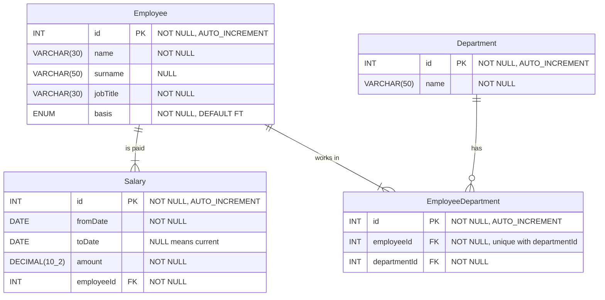

# Checkpoint 05: Physical ERD

## Goal

Refine the ICEAdmin design into a physical ERD for MariaDB, using ERD Editor, and export it as SQL.

## Concepts

### Logical and physical

A logical design describes the data. A physical design describes how one particular database will store it. To go from logical to physical we decide:

- the database model: relational
- the exact system: MariaDB
- a primary key for every table, and foreign keys for every relationship
- that no many-to-many relationships remain (checkpoint 03)
- a data type for every attribute

### Data types

Choose the smallest type that safely holds every value the column will ever need. These are the MariaDB types you will use most.

| Type | Holds | Use for |
|---|---|---|
| `INT` | Whole numbers from about -2.1 billion to 2.1 billion | Ids, counts |
| `SMALLINT` | Whole numbers from -32,768 to 32,767 | Small counts, years |
| `DECIMAL(M,D)` | Exact numbers with M digits in total, D of them after the decimal point | Money, and any measurement that must not drift |
| `DOUBLE` | Approximate floating-point numbers | Scientific values where tiny rounding errors don't matter |
| `VARCHAR(n)` | Text of up to n characters | Names, titles, short text |
| `TEXT` | Longer text, up to 65,535 bytes | Descriptions |
| `DATE` | A date, written `YYYY-MM-DD` | Birthdays, start and end dates |
| `DATETIME` | A date and time, written `YYYY-MM-DD hh:mm:ss` | Events at a specific moment |
| `ENUM(...)` | One value from a fixed list | See below |

Three traps:

- Never store money as `FLOAT` or `DOUBLE`. They hold approximations in binary, so 0.1 + 0.2 does not come out as exactly 0.3, and pennies go missing in totals. Use `DECIMAL(10,2)`: up to 99,999,999.99, stored exactly.
- `INT(11)` does not mean "11 digits allowed". The number in brackets is only a display width and doesn't change the range. Write plain `INT`.
- `YEAR` only covers 1901 to 2155. For historical years, use `SMALLINT`.

MariaDB also accepts the SQL standard names (`CHARACTER VARYING`, `INTEGER` and so on), but the short names above are what you will see in practice. These types behave the same way in MySQL.

### NULL and NOT NULL

`NOT NULL` means a value is required. `NULL` means the column may be left empty. Make a column `NOT NULL` unless there is a real reason for it to be empty. In ICEAdmin:

- `Salary.toDate` is `NULL`, because an empty `toDate` means "this is the current salary".
- `Employee.surname` is `NULL`, because some people have only one name.
- Everything else is `NOT NULL`.

Primary keys are always `NOT NULL`.

### AUTO_INCREMENT

An `AUTO_INCREMENT` column receives the next number automatically when you insert a row without it. Use it on every surrogate `id` primary key so that you never have to choose ids by hand.

### Defaults

A default is the value a column takes when an insert doesn't mention it. It saves typing and makes the common case automatic. It only applies when the column is left out. Inserting an explicit `NULL` into a `NOT NULL` column is still an error.

### ENUM: the employment basis

The physical design adds an attribute that was not in the scenario: `basis`, recording whether an employee works full-time or part-time.

```sql
basis ENUM('FT', 'PT') NOT NULL DEFAULT 'FT'
```

- `ENUM` restricts the column to the listed values. Inserting `'XX'` fails.
- `NOT NULL DEFAULT 'FT'` means every employee has a basis, and anyone added without one is full-time.

Use `ENUM` only for short lists that are fixed by nature and that you will never need to describe further. If the list may grow, or each value needs its own data (a name, a description, a rate), make it a table and link to it with a foreign key. Adding a value to an `ENUM` means changing the table's structure, while adding a row to a lookup table does not.

### Unique pairs in the linking table

`EmployeeDepartment` has its own `id`, but that does not stop the same employee and department being paired twice. Add a unique index on `(employeeId, departmentId)` so that each pair can exist only once. Every linking table you design from now on needs one.

### The ICEAdmin physical design

[reference/schema.sql](reference/schema.sql) is the reference design written as SQL. This is the diagram you are going to build:



Mermaid can't show a comma inside a type, so the diagram writes `DECIMAL(10_2)`. In SQL it is `DECIMAL(10,2)`. For physical designs you use ERD Editor, which handles this properly and can export the SQL for you.

## Steps

1. In this folder, create a file called `iceadmin.erd`. VS Code opens it in ERD Editor.
2. Right-click the canvas, choose Database and select MariaDB.
3. Right-click the canvas, open View Option and turn on DataType, Not Null, Auto Increment, Default and Relationship.
4. Add the four tables and their columns as shown in the diagram above. Set each column's data type, Not Null, Auto Increment and Default to match.
5. Make each `id` a primary key: right-click the column and choose Primary Key.
6. Add the three relationships with the One N relationship tool. Click the parent (one side) first, then the child.
7. Add a unique index on EmployeeDepartment covering `employeeId` and `departmentId`.
8. Right-click the canvas, choose Export, then SQL DDL. Save the export over `schema.sql` in this folder.
9. Run `scripts/validate.sh` from the repository root. Your `schema.sql` must pass.
10. Compare your `schema.sql` with `reference/schema.sql`. Constraint names and column order may differ. Types, nullability, defaults, keys and the unique index should not.

If you are starting here, the ICEAdmin scenario is in [checkpoint 01](../01-requirements/README.md) and the resolved design is in [checkpoint 03](../03-many-to-many/README.md).

## Done when

- [ ] `iceadmin.erd` contains four tables and three one-to-many relationships.
- [ ] `amount` is `DECIMAL(10,2)`.
- [ ] `basis` is `ENUM('FT','PT') NOT NULL DEFAULT 'FT'`.
- [ ] `schema.sql` is your ERD Editor export and contains a unique index on `(employeeId, departmentId)`.
- [ ] `scripts/validate.sh` reports PASS for your `schema.sql`.

## Previous / Next

Previous: [04 Logical design exercises](../04-logical-exercises/README.md). Next: [06 Physical design exercises](../06-physical-exercises/README.md).
