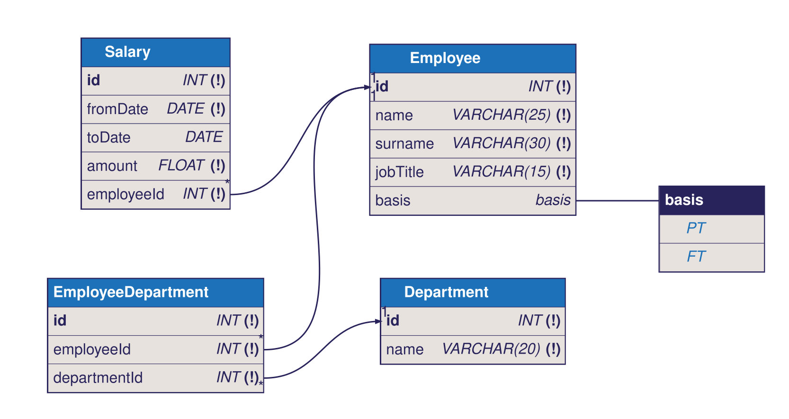

# Unit 3 demo: Creating The Physical Design

A presenter script for slides #4.3.1 to #4.3.5. It builds the `IceAdmin` database, fills it with data, changes the data, and changes a structure.

All SQL files are in `sql/`. Run them in SQLTools with **Run on active connection**, or with Ctrl+Alt+Enter (Cmd+Alt+Enter on macOS) once the shortcut is set up in step 3.

## Before the demo

1. Start Docker Desktop. Then start the database from the repository root:

   ```sh
   docker compose up -d --wait
   ```

2. In SQLTools, add a connection named `Docker DB`. Use the MariaDB/MySQL driver, server `localhost`, port `3306`, user `root`, and the password set in `docker-compose.yml`.
3. Connect, and check that `SHOW DATABASES;` returns a list.
4. To reset after a previous run, run `DROP DATABASE IF EXISTS IceAdmin;`. Then run `01_ddl.sql` and `02_dml.sql` again. This deletes all IceAdmin data, so confirm first.

## Steps

### 1. Connect to MariaDB

- File: none.
- Action: in the SQLTools sidebar, connect to `Docker DB` and expand it.
- Say: "This is the database server. `sys` and the other system databases come with it."
- Slide: #4.3.1

### 2. Create the database and tables

- File: `sql/01_ddl.sql`
- Action: Run on active connection. Then refresh the connection to show `IceAdmin`.
- Say: "Tables with no foreign keys come first, because a foreign key can only point at a table that already exists."
- Slide: #4.3.1, #4.3.2

### 3. Set up the run shortcut

- File: none.
- Action: Command Palette, then `SQLTools Connection: Run Current Query`. Click the gear icon (Configure Keybinding) and press Ctrl+Alt+Enter (Cmd+Alt+Enter on macOS).
- Say: "Now one key runs the statement under the cursor."
- Slide: #4.3.1

### 4. Reverse engineer the ERD

- File: `iceadmin.vuerd.json` in this folder. If it is missing, create an empty file with that name and it opens in Vuerd.
- Action: right-click the canvas, then Import, then SQL DDL, and choose `sql/01_ddl.sql`.
- Say: "The tool reads the DDL and draws the diagram. Compare it with the physical ERD from Unit 2."
- Slide: #4.3.3

### 5. Forward engineer the DDL

- File: `iceadmin.vuerd.json`
- Action: right-click the canvas, then Export, then SQL DDL.
- Say: "The output is the same design, but the tool names the constraints and orders the statements its own way."
- Slide: #4.3.3

### 6. Insert data

- File: `sql/02_dml.sql`, then `sql/00_verify.sql`
- Action: Run on active connection for each.
- Say: "Parent rows go in first, so every foreign key has a row to point at."
- Slide: #4.3.5

### 7. Update and delete, with rollback

- File: `sql/03_dml_changes.sql`
- Action: Run on active connection. Point out the two `SELECT` results: the row is gone, then it is back.
- Say: "Inside a transaction, ROLLBACK undoes the DELETE. Always write a WHERE on UPDATE and DELETE."
- Slide: #4.3.4

### 8. Change and remove a structure

- File: `sql/04_structure_changes.sql`
- Action: Run on active connection. Then run `SHOW TABLES;` to show that `ScratchDemo` is gone.
- Say: "ALTER, TRUNCATE and DROP commit straight away, so ROLLBACK cannot bring them back."
- Slide: #4.3.1

### 9. Optional: commit and push

- File: none.
- Action: Command Palette, then `Git: Commit`, `Git: Rename Branch` if needed, then `Git: Push`. Push only after the presenter confirms.
- Say: "Check the branch name before you push. Do not assume it is `master`."
- Slide: none.

## Extra: from DBML to the database

`iceadmin.dbml` is the same physical design as `01_ddl.sql`, written as DBML, a short text format for diagrams. `iceadmin.svg` is the diagram drawn from it.



Three commands take the design from DBML into MariaDB. Run them from the repository root, with the database running.

1. Turn the DBML into MariaDB DDL:

   ```sh
   cd modules/m4-relational-databases/u3-physical-design/demo
   npx -y -p @dbml/cli@10.3.1 dbml2sql iceadmin.dbml --mysql -o sql/05_ddl_from_dbml.sql
   cd -
   ```

2. Create an empty database for it. A separate name keeps it apart from `IceAdmin`, so the two can be compared:

   ```sh
   echo "CREATE DATABASE IceAdminDbml;" | scripts/sql.sh
   ```

3. Apply the DDL:

   ```sh
   scripts/sql.sh IceAdminDbml < modules/m4-relational-databases/u3-physical-design/demo/sql/05_ddl_from_dbml.sql
   ```

Refresh the SQLTools connection and compare `SHOW CREATE TABLE Salary;` in both databases. The tables match, except that the DBML note on `toDate` becomes a column `COMMENT`. The generated file creates every table first, then adds the foreign keys with `ALTER TABLE`, so table order no longer matters. The diagram does not hold a database name, which is why step 2 creates one.

To redraw the diagram after editing the DBML:

```sh
npx -y @softwaretechnik/dbml-renderer@1.0.31 -i iceadmin.dbml -o iceadmin.svg
```

To remove the copy: `DROP DATABASE IceAdminDbml;`.

## Notes for the presenter

- The slides show `UPDATE Employee SET Salary = 40000 WHERE id = 2;`. That fails, because `Employee` has no `Salary` column. Salary lives in the `Salary` table, one row per period. `03_dml_changes.sql` uses the correct form.
- Transactions protect DML (INSERT, UPDATE, DELETE). They do not protect DDL (CREATE, ALTER, TRUNCATE, DROP), which auto-commits in MariaDB and MySQL.
- `01_ddl.sql` matches the slides. The exercises in this repository go further: money is stored as `DECIMAL(10,2)`, because `FLOAT` cannot hold every amount exactly, and a linking table gets `UNIQUE (employeeId, departmentId)`, so the same pair cannot be stored twice.
- `IceAdmin` is a separate database from the Unit 2 `iceadmin`. Database names are case-sensitive on Linux, and the Docker server runs Linux.
- `01_ddl.sql` and `02_dml.sql` are not safe to run twice. Reset first (see Before the demo).
