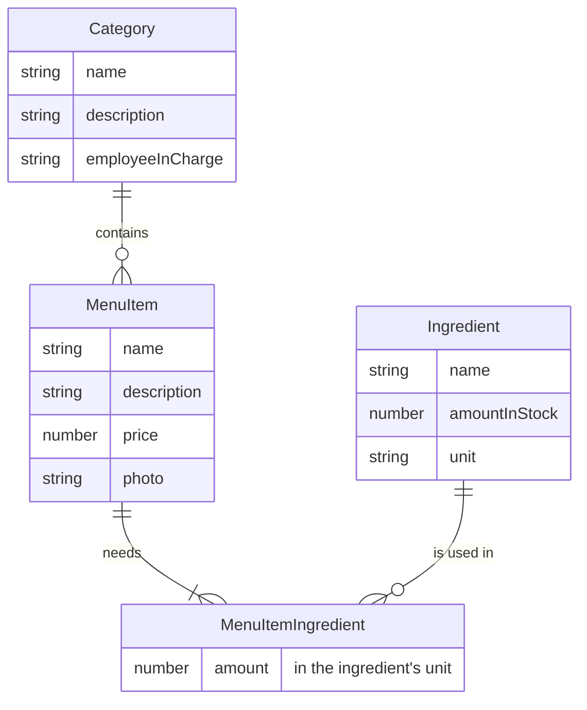

# Exercise 2.1: Restaurant, logical ERD

Assumptions:

- Every dish needs at least one ingredient.
- A category may be empty for a while, for example a new category before any items are added to it.
- The amount a dish needs is in the same unit as the ingredient's stock.
