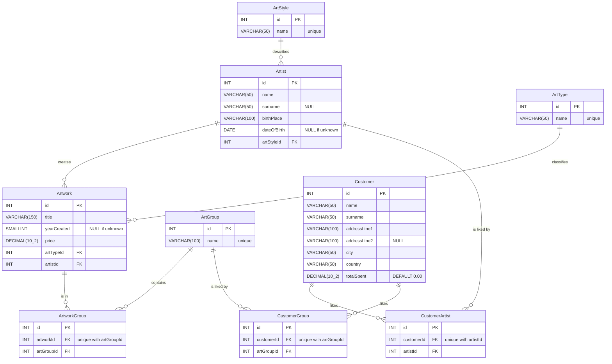

# Exercise 2.3: Gallery, physical ERD

All columns are `NOT NULL` unless marked `NULL`. Every `id` is `AUTO_INCREMENT`. `DECIMAL(10_2)` stands for `DECIMAL(10,2)`, because Mermaid can't show the comma.
